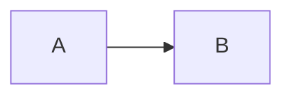

# Heading one

Some **bold**, *italic*, `code`, ==highlight== and a [link](https://example.com).
A [[wiki link]] and inline math $e^{i\pi} + 1 = 0$.

$$
\int_0^1 x^2\,dx = \tfrac{1}{3}
$$

> A quote.

- [ ] task
- [x] done

| a | b |
|---|---|
| 1 | 2 |

```swift
let hello = "world"
```


